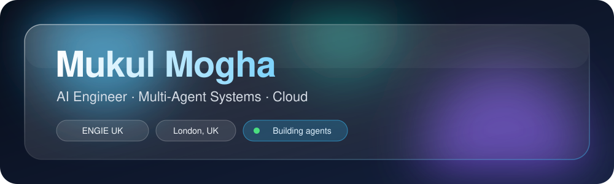
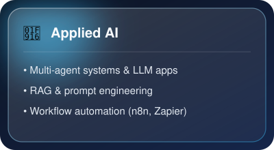
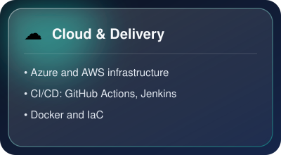
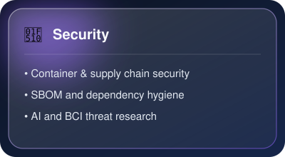
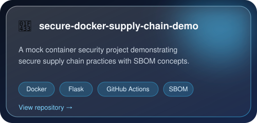
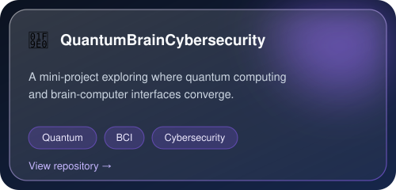

 

**[About](#-about) · [Now](#-currently) · [Experience](#-experience) · [Focus](#-focus-areas) · [Stack](#-tech-stack) · [Projects](#-featured-projects) · [Connect](#-lets-connect)**

 

## 👋 About

> **I turn AI research into reliable products.**

I'm an **AI Engineer (Application Manager) at [ENGIE UK](https://www.linkedin.com/company/1992581/)**, designing and building **scalable multi-agent systems** for real-world business problems. I care about the whole journey: from prototype to secure, production-ready software.

🎓 **MSc Cloud Computing**, University of East London &nbsp;·&nbsp; 📍 **London, UK**

 

## ⚡ Currently

| 🔭 Building | 🤖 Using | 🔐 Exploring | 🌱 Learning |
| :--- | :--- | :--- | :--- |
| KYC background verification tool with an **agentic workflow** | **Microsoft Agentic Framework**, IaC with a Git workflow, AI-assisted development | **AI security** and secure software supply chains | **Quantum computing** and brain-computer interfaces |

 

## 💼 Experience

<table>
<tr>
<td width="140" align="center"><b>Jan 2026 → Present</b></td>
<td><b>AI Engineer (Application Manager)</b> · <a href="https://www.linkedin.com/company/1992581/">ENGIE UK</a> 
Building a KYC background verification tool that uses an agentic workflow to automate manual data checks.</td>
</tr>
</table>

<b>▸ Earlier roles (click to expand)</b>

 

| Period | Role | Company | Highlights |
| :--- | :--- | :--- | :--- |
| **Jan 2025 – Dec 2025** | AI Engineer (Freelance) | HireMeHub | AI-driven career services platform that optimises job application materials, built with n8n, Zapier and Pipedream |
| **Nov 2023 – Jun 2025** | Software Engineer, AI Agentic Consultant (Contract) | K3-Innovations, Inc. | Django data-processing web app with AWS services, REST APIs and ETL pipelines, with a **30% performance improvement** |
| **Nov 2022 – Sep 2023** | Software Engineer, Azure | Accenture | Streamlined ServiceNow request processes and escalations (**20% lower ticket backlog**); MSSQL patching and migrations on Azure |
| **Feb 2022 – Jul 2022** | Graduate Engineering Trainee, ServiceNow Analyst | Birlasoft | Monitoring tools and Power BI / SQL / Python reporting dashboards |

 

## 🎯 Focus Areas

<table>
<tr>
<td width="33%"></td>
<td width="33%"></td>
<td width="33%"></td>
</tr>
</table>

 

## 🧰 Tech Stack

<b>▸ Toggle tech stack</b>

 

**AI & Data** 

**Backend** 

**Cloud & DevOps** 

 

## 🚀 Featured Projects

<table>
<tr>
<td width="50%"></td>
<td width="50%"></td>
</tr>
</table>

 

## 🤝 Let's Connect

Open to conversations about **AI agents, cloud and AI security**.

 

*"The best way to predict the future is to build it."*

