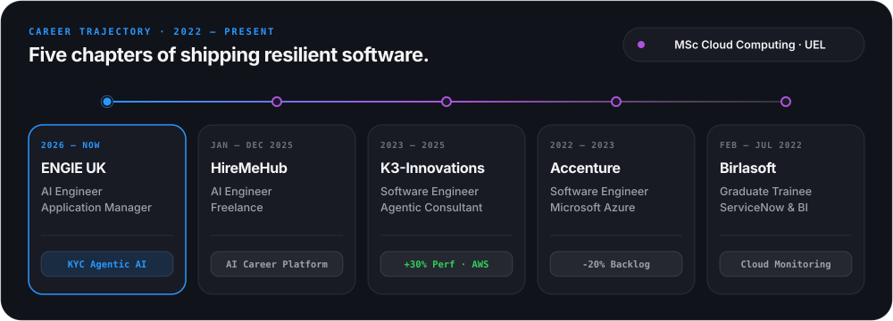

<picture>
  <source media="(prefers-color-scheme: dark)" srcset="./assets/hero-dark.svg">
  <source media="(prefers-color-scheme: light)" srcset="./assets/hero-light.svg">
  
</picture>

 

<a href="https://www.linkedin.com/in/mukul-mogha/"><picture><source media="(prefers-color-scheme: dark)" srcset="./assets/pill-linkedin-dark.svg"><source media="(prefers-color-scheme: light)" srcset="./assets/pill-linkedin-light.svg"></picture></a>&nbsp;&nbsp;<a href="#system-architecture"><picture><source media="(prefers-color-scheme: dark)" srcset="./assets/pill-architecture-dark.svg"><source media="(prefers-color-scheme: light)" srcset="./assets/pill-architecture-light.svg"></picture></a>&nbsp;&nbsp;<a href="#career-trajectory"><picture><source media="(prefers-color-scheme: dark)" srcset="./assets/pill-trajectory-dark.svg"><source media="(prefers-color-scheme: light)" srcset="./assets/pill-trajectory-light.svg"></picture></a>&nbsp;&nbsp;<a href="#featured-engineering"><picture><source media="(prefers-color-scheme: dark)" srcset="./assets/pill-projects-dark.svg"><source media="(prefers-color-scheme: light)" srcset="./assets/pill-projects-light.svg"></picture></a>

 

<picture>
  <source media="(prefers-color-scheme: dark)" srcset="./assets/bento-dark.svg">
  <source media="(prefers-color-scheme: light)" srcset="./assets/bento-light.svg">
  
</picture>

<b>⊕ Interactive Spec 01 — Autonomous KYC Multi-Agent Architecture (ENGIE UK)</b> &nbsp;Click to expand technical breakdown

 

> Designed around deterministic policy gates and auditable Infrastructure-as-Code workflows so autonomous agents operate safely in enterprise compliance environments.

| Stage | Subsystem | Responsibility |
| :--- | :--- | :--- |
| `01 · INGEST` | **Intake Node** _(Doc Parsing)_ | Normalizes unstructured KYC filings and validates schema integrity. |
| `02 · EXTRACT` | **Entity Agent** _(Signal Synthesis)_ | Extracts corporate entities, registries, and risk indicators autonomously. |
| `03 · VERIFY` | **Policy Agent** _(Cross-Check)_ | Evaluates extracted evidence against compliance rules with deterministic checks. |
| `04 · AUDIT` | **IaC Gate** _(Verified Output)_ | Produces auditable verification dossiers deployed via GitOps infrastructure. |

- **Orchestration & Tooling:** Microsoft Agentic Framework · GitOps Workflow for IaC · AI-Assisted Specification & Verification
- **Active Research:** Secure AI/Container Supply Chains (SBOM provenance) · Quantum Computing & Brain-Computer Interface (BCI) threat surfaces

 

<picture>
  <source media="(prefers-color-scheme: dark)" srcset="./assets/experience-dark.svg">
  <source media="(prefers-color-scheme: light)" srcset="./assets/experience-light.svg">
  
</picture>

<b>⊕ Interactive Spec 02 — Career Telemetry &amp; Production Deliverables (2022 – Present)</b> &nbsp;Click to expand role history

 

| Timeline | Organization &amp; Role | Key Engineering Outcome |
| :--- | :--- | :--- |
| **Jan 2026 – Present** | **ENGIE UK** — _AI Engineer (Application Manager)_ London, UK · On-site | Architecting an autonomous KYC background verification tool using the Microsoft Agentic Framework and Git workflows for Infrastructure as Code (IaC). |
| **Jan 2025 – Dec 2025** | **HireMeHub** — _AI Engineer (Freelance)_ London, UK · Remote | Built an AI-driven career platform optimizing technical application materials through automated n8n, Zapier, and Pipedream orchestration. |
| **Nov 2023 – Jun 2025** | **K3-Innovations** — _Software Engineer — AI Agentic Consultant (Contract)_ United States · Remote | Engineered AWS + REST ETL pipelines and a full-stack Python (Django) analytics platform, boosting data-processing and query performance by 30%. |
| **Nov 2022 – Sep 2023** | **Accenture** — _Software Engineer — Azure_ Hybrid | Automated ServiceNow request and escalation workflows (reducing ticket backlog by 20%) and led zero-downtime MSSQL patching & migrations on Azure. |
| **Feb 2022 – Jul 2022** | **Birlasoft** — _Graduate Engineering Trainee — ServiceNow Analyst_ Noida, India · Remote | Developed cloud monitoring utilities and executive Power BI, SQL, and Python reporting dashboards for enterprise client operations. |

- **Academic Foundation:** **MSc Cloud Computing**, University of East London _(London, United Kingdom)_

 

<a href="https://github.com/Mukul2601/secure-docker-supply-chain-demo"><picture><source media="(prefers-color-scheme: dark)" srcset="./assets/project-supply-chain-dark.svg"><source media="(prefers-color-scheme: light)" srcset="./assets/project-supply-chain-light.svg"></picture></a>&nbsp;<a href="https://github.com/Mukul2601/QuantumBrainCybersecurity"><picture><source media="(prefers-color-scheme: dark)" srcset="./assets/project-quantum-dark.svg"><source media="(prefers-color-scheme: light)" srcset="./assets/project-quantum-light.svg"></picture></a>

<b>⊕ Interactive Spec 03 — Full Engineering &amp; Cloud Specifications</b> &nbsp;Click to expand complete stack

 

| Domain | Technologies &amp; Practices |
| :--- | :--- |
| **Applied AI &amp; Agents** | Multi-Agent Systems · Microsoft Agentic Framework · LangChain · PyTorch · TensorFlow · RAG &amp; Evaluation · n8n · Zapier · Pipedream |
| **Backend &amp; Data** | Python · Django · Flask · REST APIs · ETL Pipelines · MSSQL · SQL · Power BI |
| **Cloud &amp; MLOps** | Microsoft Azure · AWS · Docker · GitHub Actions · Jenkins · GitOps IaC · Linux · ServiceNow Automation |
| **Security &amp; Resilience** | Container Hardening · SBOM &amp; Dependency Provenance · Agentic Guardrails · Quantum / BCI Threat Modeling |
| **Profile Engine** | Built in **TypeScript** (`src/`) — run `npm run generate` to recompile all adaptive Dark/Light SVG scenes and `README.md`. |

 

<a href="https://www.linkedin.com/in/mukul-mogha/"><picture><source media="(prefers-color-scheme: dark)" srcset="./assets/footer-dark.svg"><source media="(prefers-color-scheme: light)" srcset="./assets/footer-light.svg"></picture></a>

  

